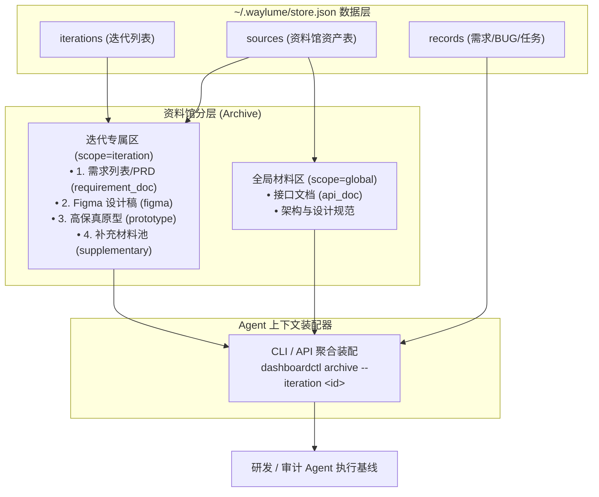
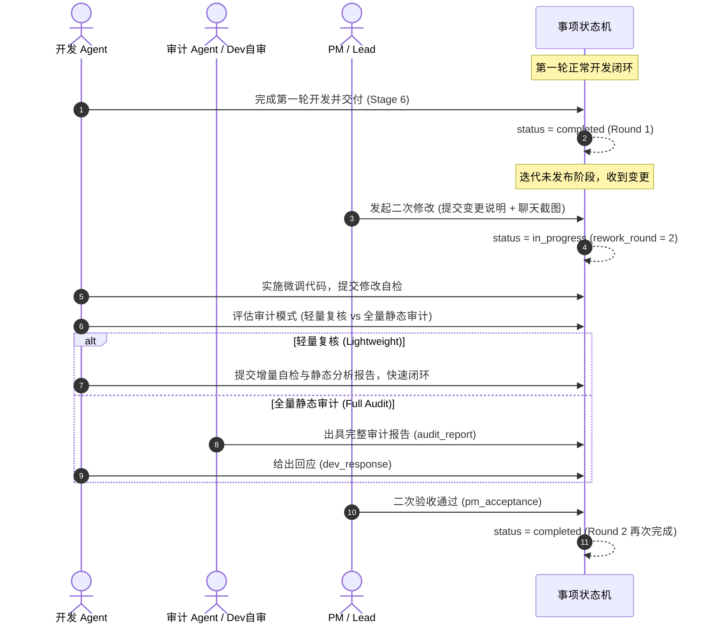

# 知途工作台：版本迭代驱动与「资料馆」改造技术方案与开发计划

版本：v1.0  
定稿日期：2026-11-18  
状态：设计已定稿，待开发实施  
关联需求：ZT-R025  
关联合同/事项：AGENT-WAYLUME-ITERATION-ARCHIVE-20261118  

---

## 1. 业务背景与改造目标

### 1.1 现状与业务痛点
1. **资料管理扁平无版本容器**：当前「资料库」以单文档的插槽形式（需求文档、Figma、CoDesign、接口文档）组织，依赖 `AGENTS.md` 建立索引。但在实际敏捷软件研发中，需求与设计不是孤立的文档，而是严格绑定在**「版本 / 迭代」**周期内的（如 `v13.4.2 迭代`）。
2. **发布前完成即折叠违背研发规律**：目前工作台任务一旦标记为“已完成”，便会自动收进折叠区。然而在版本正式上线发布前，“完成”往往只是阶段性的，PM 临时调整细节、UI 视觉微调、接口变更或联调问题，都会让已完成的需求再次被拿出来修改。折叠隐藏造成操作与检索摩擦。
3. **缺少发布前二次修改与再审计的闭环追踪**：现有六阶段流水线（`intake` ➔ `delivery`）在任务完成后未建立直观的“二次修改 ➔ 再审计 ➔ 再验收”的版本化轮次追踪机制。
4. **Agent 缺乏精准上下文边界**：Agent 读取材料时难以区分“哪些是当前迭代专有资产”、“哪些是跨版本公用规范”。

### 1.2 改造目标
1. **资料库升级为「资料馆 (Archive)」**：
   - 建立**全局独立材料区**（接口文档、通用架构规范，跨版本共享）。
   - 建立**版本/迭代专属材料区**（每个迭代固定包含：需求列表、Figma、高保真原型、补充材料池）。
   - 补充材料池（PM 聊天截图、会议备忘、临时微调草图）支持**迭代级**与**任务级**双层归属。
2. **任务卡按版本迭代分组 + 未发布前零折叠**：
   - 工作台主页与需求模块任务卡按迭代聚合。
   - 在迭代正式「发布」前，本迭代的全部任务（包含已完成任务）**一律不折叠**，平铺保持在可视区，标记为已完成并支持直接查看与发起修改。
   - 迭代发布后，全组整体收拢归档。
3. **完成 ➔ 修改 ➔ 再审计 ➔ 再完成的状态机闭环**：
   - 支持已完成任务在发布前触发修改（Rework），记录修改轮次（Round N）与变更原因/截图证据。
   - **由 Agent 自主决策审计级别**：根据改动影响面，自主选择全量静态审计或轻量快速复核。
   - 详情页 Stepper 与 Timeline 完整展示多轮完成与修改轨迹。
4. **Agent 上下文自动化装配**：
   - 提供标准 CLI 与 API，Agent 认领任务时按 `全局材料 + 迭代专属四大资产 + 任务历史` 自动装配上下文，动态生成 `AGENTS.md` 索引。

---

## 2. 系统架构与数据模型设计



### 2.1 迭代数据模型 (`iterations`)
在 `store.json` 根级新增 `iterations` 列表：

```json
{
  "iterations": [
    {
      "id": "ITER-202611-v1342",
      "version_tag": "v13.4.2",
      "title": "13.4.2 智能相册与AI音乐优化",
      "status": "active", // planning | active | pending_release | released | archived
      "target_release_date": "2026-11-30",
      "released_at": null,
      "created_at": "2026-11-18T10:00:00+08:00",
      "updated_at": "2026-11-18T10:00:00+08:00",
      "description": "包含 Wan3.0 适配、本地音乐列表滚动优化及埋点修复",
      "notes": []
    }
  ]
}
```

### 2.2 资料馆数据模型 (`sources` 升级)
现有 `sources` 扩展 `scope`、`iteration_id` 以及 `slot` 类型：

```json
{
  "id": "src-iter-v1342-prd",
  "scope": "iteration", // "global" | "iteration"
  "iteration_id": "ITER-202611-v1342", // 当 scope 为 iteration 时必填；global 为 null
  "slot": "requirement_doc", // "requirement_doc" | "figma" | "prototype" | "supplementary" | "api_doc" | "other"
  "name": "13.4.2 PRD 需求清单",
  "type": "link", // "link" | "file"
  "url": "https://wiki.example.com/prd/v1342",
  "version_label": "v1.2",
  "version_no": 2,
  "inspection_enabled": true,
  "attachments": [], // supplementary 槽位专用，挂载截图/文本
  "added_at": "2026-11-18T10:30:00+08:00"
}
```

#### 补充材料结构 (`attachments` / `supplementary`)：
支持在**迭代专属区**或**单个任务详情**中追加截图/聊天记录：
```json
{
  "id": "att-20261118-01",
  "filename": "pm_chat_dialog_fix.png",
  "mime_type": "image/png",
  "summary": "PM 确认：弹窗底部取消按钮改为文字链接样式，不用强按钮",
  "local_path": "sources/attachments/ITER-202611-v1342/pm_chat_dialog_fix.png",
  "download_url": "/api/attachments/att-20261118-01",
  "uploaded_at": "2026-11-18T14:20:00+08:00",
  "uploader": "gemini"
}
```

### 2.3 事项模型扩展 (`records`)
在 `record` 对象中增加迭代关联与二次修改轮次字段：
```json
{
  "iteration_id": "ITER-202611-v1342", // 所属迭代，null 则属于未规划需求池 (Backlog)
  "reopen_count": 1, // 发起二次修改的轮次
  "reopen_history": [
    {
      "round": 1,
      "reopened_at": "2026-11-18T14:30:00+08:00",
      "reason": "PM 补充要求：调整弹窗取消样式并补充曝光埋点",
      "evidence": ["att-20261118-01"],
      "audit_mode": "lightweight", // "full" (全量审计) | "lightweight" (轻量复核)
      "completed_at": "2026-11-18T16:00:00+08:00"
    }
  ]
}
```

---

## 3. 需求流转状态机：完成 ➔ 修改 ➔ 再审计 ➔ 再完成



### 状态机流转细则：
1. **触发时机**：只要任务所属迭代的 `status != "released"`，且任务处于 `completed` 状态，即可调用 `reopen` / 发起修改。
2. **审计决策权由 Agent 裁定**：
   - **轻量复核 (`lightweight`)**：改动仅涉及文案调整、纯 CSS 间距精修、局部非核心逻辑修补。Agent 可直接提交增量自检记录与静态检查结果，跳过外部 Auditor 阶段锁，快速进入 PM 验收。
   - **全量静态审计 (`full`)**：涉及跨模块接口、数据结构变更、鉴权/安全逻辑、或重构逻辑。必须严格经历 Auditor 报告 ➔ Dev 回应 ➔ PM 验收完整六阶段。

---

## 4. 前端界面与交互规范

### 4.1 主页任务卡：按迭代分组与零折叠
1. **布局结构**：
   - 顶部显示**迭代切换与概览**（当前活跃迭代、迭代发布状态、目标日期）。
   - 下方依次平铺：
     - **当前活跃迭代 (`active` / `pending_release`) 区域**：
       - 进行中任务卡片；
       - **已完成任务卡片（常驻展开展示）**：采用绿色语义勾选标签与轻量卡片样式，**绝不收缩至 `<details>` 折叠层**。一览无余，卡片内保留直接打开详情与「发起修改」按钮。
     - **待规划需求池 (Backlog)**：未指定迭代的临时需求与长远任务。
     - **已发布迭代历史 (Released History)**：已正式发布的历史迭代整体折叠收录，支持展开回溯。
2. **迭代发布动作**：
   - 迭代卡片头部提供「标记迭代发布」按钮（支持权限校验）。
   - 仅当点击该按钮确认发布后，该迭代才整体封存，并收录进历史折叠区。

### 4.2 资料馆 (Archive) 双层视图
1. **全局资料区**：
   - 包含常驻的「接口文档」和「公共规范」槽位，支持配置在线链接、离线 Swagger/Markdown 文件与巡检开关。
2. **迭代专属资料区**：
   - 四大固定卡片：
     - **需求列表 / PRD** (可上传 Markdown、在线协作文档)；
     - **Figma 设计稿** (嵌入直达链接与版本说明)；
     - **高保真原型** (CoDesign / 原型包 / 演示视频)；
     - **补充材料池** (PM 聊天记录截图列表、会议纪要、变更说明卡片流，支持一键放大预览)。

---

## 5. 详细分阶段实施计划 (Work Breakdown Structure)

### Phase 1: 数据模型与存储引擎改造 (Backend Core)
- [ ] **1.1 迭代数据结构扩展**：在 `backend.py` 与 `store.json` 支持 `iterations` 列表读写与 CAS 并发控制。
- [ ] **1.2 资料馆分层存储 (`sources` 升级)**：新增 `scope`、`iteration_id`、`attachments` 字段校验，兼容旧版 slot。
- [ ] **1.3 事项关联与二次修改状态机**：在 `workflow.py` 与 `dashboardctl.py` 中引入 `reopen` 操作、轮次计数及 `lightweight` / `full` 审计分支。
- [ ] **1.4 单元测试覆盖**：编写 `tests/test_archive.py` 与 `tests/test_iteration_workflow.py`，保证 100% 自动化测试通过。

### Phase 2: CLI 工具与 Agent 上下文契约 (Agent Integration)
- [ ] **2.1 `dashboardctl.py` 命令扩展**：
  - `iteration list / create / switch / release`
  - `archive list --iteration <id> --include-global`
  - `reopen <id> --reason <text> --audit-mode <lightweight|full> [--attachment <path>]`
- [ ] **2.2 上下文装配与 `AGENTS.md` 动态索引**：改造工作台导出函数，自动生成包含 `[全局接口与规范] + [本迭代四项资产] + [本任务修改历史]` 的索引内容。

### Phase 3: 前端主页迭代分组与「零折叠」重构 (UI Dashboard)
- [ ] **3.1 改造 `dashboard-model.js` 数据分组器**：移除未发布迭代下完成项进入 `fold-card` 的逻辑，按 `iteration_id` 分组并直接平铺输出。
- [ ] **3.2 主页迭代分组视图渲染**：在 `web/index.html` 与 `web/assets/dashboard.js` 中渲染迭代标题条、状态徽标及未发布不折叠的任务卡片流。
- [ ] **3.3 迭代发布交互**：在迭代条提供发布入口，发布确认后平滑过渡收起。

### Phase 4: 前端「资料馆」与补充材料交互 (UI Archive)
- [ ] **4.1 资料馆双层弹窗/页面**：重构现有资料库弹窗，清晰划分「全局材料区」与「当前迭代材料区」。
- [ ] **4.2 补充材料池卡片流**：支持上传 PM 聊天截图与便签，支持图片缩略图、富文本摘要与全屏预览。
- [ ] **4.3 任务详情页材料嵌入**：在任务详情中支持直接上传和展示针对该任务专属的 PM 变更聊天截图。

### Phase 5: 任务详情页修改流转与审计可视化 (UI Stepper & Rework)
- [ ] **5.1 详情页「发起修改」交互**：对未发布迭代的已完成任务提供「发起修改」按钮，输入变更理由、选择审计模式、上传截图。
- [ ] **5.2 状态流转时间轴多轮展示**：Stepper 与 Timeline 视觉化呈现第一轮交付 ➔ 二次修改 ➔ 再审计 ➔ 再完成的轨迹。

### Phase 6: 历史数据兼容迁移与全链路回归 (Migration & Verification)
- [ ] **6.1 数据平滑迁移脚本**：现有旧记录自动挂载到默认生成的首个活跃迭代（如 `v13.4.2 迭代`），旧 `sources` 自动映射为全局或首迭代资料，保证零数据丢失。
- [ ] **6.2 视觉与契约回归测试**：运行 `test_frontend_contract.py`、`test_dashboard_model.test.js` 以及浅色/深色主题视觉回归验证。

---

## 6. 后续 Agent 开发指引与交接红线

1. **不可破坏历史数据与未提交代码**：工作台所有新增字段必须向后兼容，缺省字段提供合理 fallback。
2. **严格遵循苹果极简视觉体系**：UI 修改必须限定在既有 CSS 变量与设计节奏内（4px 间距节奏、浅色 `#f5f5f7`、纯白发丝描边卡片、深色 `#1c1c1e`、不引入刺眼色块）。
3. **真实自动化验证放行**：任何阶段实施完毕后，必须以 `python3 -m unittest` 与前端自动化测试通过为提交基线。

---

## 2026-11-19 返工修订（验收反馈）

用户验收初版后指出 11 项问题；本轮只修订其中代码与 UI 部分（问题 1–6、8、9），数据整理与新增「13.4.0 埋点」版本仍由 Lead 在开发完成后执行。与原方案的差异如下：

1. **取消「当前版本」概念**：删除整条版本栏与当前版本下拉；所有版本按显式 `order`（缺省按 `created_at`）平铺展示，支持多版本同屏。新增「编辑版本」入口与版本管理弹窗，负责新建（可插入任意位置）、改名、排序、需求归属与按版本标记发布。`current_iteration_id` 仅作为后端兼容字段保留，不再驱动界面隐藏或折叠。
2. **版本名唯一**：原方案允许 `version_tag` 与 `title` 并列展示；返工后 `iterationName` 以标题优先、tag 为兼容字段，只在确实不同时作为 title 提示，不再拼出第二个可见名字。编辑与新建只维护一个「版本名」。
3. **资料馆只保留两个标签**：删除「当前版本资料 / 历史版本归档 / 全局公共材料」三标签，改为「版本资料 / 公共材料」。版本资料按首页顺序展示全部版本矩阵；历史版本不再单独归档。
4. **补充材料即原「其他来源」**：删除独立「补充材料池」与「其他来源」双列表。每个版本或公共材料范围内，固定槽位之外的资料统一进入该范围的「补充材料」列表。
5. **严格按范围隔离**：`archiveView` 先按 scope/iteration 分区，再在分区内选固定槽位与补充材料；固定槽位外的组只进入本范围补充材料。`assemble_archive_context` 只返回目标版本资料 + 公共材料。同一资料组的版本必须归属一致，移动时整组更新。
6. **委托任务不参与版本**：原方案把任务卡也按版本分组；返工后任务区恢复「本批 / 以前待续 / 历史批次 / 以前已完成」体系，模型层显式过滤 `type=task`（以及 BUG），任务详情不显示所属版本选择。
7. **移动材料交互重做**：以材料 group 为单位，后端整组更新；弹窗显示当前位置、整组数量、目标范围/版本/位置；成功后切到目标标签、定位高亮，toast 支持撤销；附件不提供独立移动按钮。
8. **视觉统一**：新增版块复用既有浅色/深色设计语言，不使用内联 style 与 emoji；补齐焦点、空状态、加载态、reduced-motion 与 320/390/768/1280 响应式。

原方案第 1.2 节第 2 条「迭代发布后全组整体收拢归档」不再执行：已发布版本仍作为版本分组展示，仅在组内折叠已完成记录，避免版本从首页消失。
